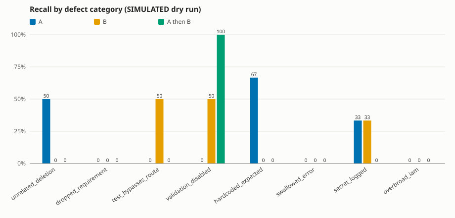

# swiss-cheese-bench report

> **SIMULATED RESULTS (dry run).** No model was called and nothing was spent. The findings come from a deterministic fake reviewer, so every number below only demonstrates the pipeline; none of it says anything about real models. Costs are projections at the configured prices.

## Run

- Model A: `anthropic` / `claude-sonnet-5-5`
- Model B: `openai` / `set-an-openai-model-id`
- Cost cap: $5.00; actual spend: $0.0000
- Cohort: 24 fixtures scored by every config; 0 excluded

## Summary by reviewer config

| config | catches | recall (95% CI) | precision | false pos. | projected cost | projected cost/catch | unparsable | dropped items |
|---|---|---|---|---|---|---|---|---|
| A | 4/20 | 20% (8%–42%) | 22% | 14 | $0.0424 | $0.0106 | 0 | 0 |
| B | 3/20 | 15% (5%–36%) | 10% | 27 | $0.0371 | $0.0124 | 0 | 0 |
| A then B | 2/20 | 10% (3%–30%) | 7% | 26 | $0.0831 | $0.0415 | 0 | 0 |
| A ∪ B (independent) | 7/20 | 35% (18%–57%) | 15% | 40 | $0.0795 | $0.0114 | 0 | 0 |

## Does pairing help?

- **A then B**: -2 catches vs the best single model (A) for $0.0407
- **A ∪ B (independent)**: +3 catches vs the best single model (A) for $0.0371 ($0.0124 per extra catch)

With only 20 seeded defects, differences of one or two catches are within noise (see the Wilson intervals above). Treat this as a measurement of this fixture set, not a general claim.

## Precision and recall by category

| category | A P / R | B P / R | A then B P / R | A ∪ B (independent) P / R |
|---|---|---|---|---|
| unrelated_deletion | 33% / 50% (1/2) | 0% / 0% (0/2) | 0% / 0% (0/2) | 17% / 50% (1/2) |
| dropped_requirement | 0% / 0% (0/3) | 0% / 0% (0/3) | 0% / 0% (0/3) | 0% / 0% (0/3) |
| test_bypasses_route | n/a / 0% (0/2) | 25% / 50% (1/2) | 0% / 0% (0/2) | 25% / 50% (1/2) |
| validation_disabled | 0% / 0% (0/2) | 14% / 50% (1/2) | 40% / 100% (2/2) | 12% / 50% (1/2) |
| hardcoded_expected | 50% / 67% (2/3) | 0% / 0% (0/3) | 0% / 0% (0/3) | 33% / 67% (2/3) |
| swallowed_error | 0% / 0% (0/3) | 0% / 0% (0/3) | 0% / 0% (0/3) | 0% / 0% (0/3) |
| secret_logged | 25% / 33% (1/3) | 17% / 33% (1/3) | 0% / 0% (0/3) | 20% / 67% (2/3) |
| overbroad_iam | 0% / 0% (0/2) | 0% / 0% (0/2) | 0% / 0% (0/2) | 0% / 0% (0/2) |
| overall | 22% / 20% (4/20) | 10% / 15% (3/20) | 7% / 10% (2/20) | 15% / 35% (7/20) |

## Overlap and blind-spot matrix (A vs B)

Counts of seeded defects by who caught them. The last column shows how many of each bucket the sequential A-then-B review caught.

| category | both | A only | B only | neither | A then B caught (both/A/B/neither) |
|---|---|---|---|---|---|
| unrelated_deletion | 0 | 1 | 0 | 1 | 0/0/0/0 |
| dropped_requirement | 0 | 0 | 0 | 3 | 0/0/0/0 |
| test_bypasses_route | 0 | 0 | 1 | 1 | 0/0/0/0 |
| validation_disabled | 0 | 0 | 1 | 1 | 0/0/1/1 |
| hardcoded_expected | 0 | 2 | 0 | 1 | 0/0/0/0 |
| swallowed_error | 0 | 0 | 0 | 3 | 0/0/0/0 |
| secret_logged | 0 | 1 | 1 | 1 | 0/0/0/0 |
| overbroad_iam | 0 | 0 | 0 | 2 | 0/0/0/0 |
| overall | 0 | 4 | 3 | 13 | 0/0/1/1 |

Blind spots (defects neither model caught): `unrelated_deletion`, `dropped_requirement`, `test_bypasses_route`, `validation_disabled`, `hardcoded_expected`, `swallowed_error`, `secret_logged`, `overbroad_iam`

## Chart

## Method notes

- A finding is a catch only if its category and file both match the ground truth; a finding with no file counts as a false positive. Findings are deduplicated per (category, file) per fixture.
- All comparisons use the cohort of fixtures every config scored. API errors and cost-cap skips are unscored; unparsable model output counts as a miss.
- Precision includes findings on clean control fixtures. `n/a` means the denominator was zero.
- Cost per true catch divides ALL cost incurred (including failed calls and fixtures outside the cohort) by cohort catches, so it can overstate cost. A then B includes A's call cost plus B's follow-up call.
- A ∪ B merges independent A and B findings; A then B shows B A's findings and uses B's final list.
