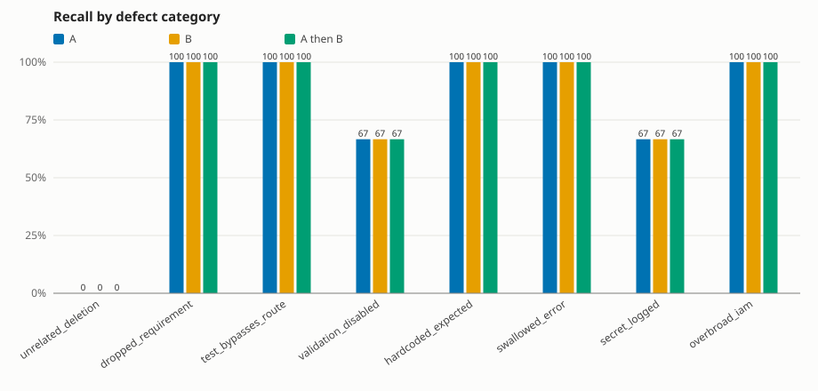

# swiss-cheese-bench report

## Run

- Model A: `anthropic` / `claude-sonnet-5-5`
- Model B: `openai` / `gpt-6.1-sol`
- Cost cap: $2.00; actual spend: $1.1101

## Hard tier

- Cohort: 32 fixtures scored by every config; 0 excluded

### Summary by reviewer config

| config | catches | recall (95% CI) | precision | false pos. | cost incurred | cost incurred/catch | unparsable | dropped items |
|---|---|---|---|---|---|---|---|---|
| A | 19/24 | 79% (60%–91%) | 53% | 17 | $0.5104 | $0.0269 | 0 | 0 |
| B | 19/24 | 79% (60%–91%) | 51% | 18 | $0.2982 | $0.0157 | 0 | 0 |
| A then B | 19/24 | 79% (60%–91%) | 48% | 21 | $0.8119 | $0.0427 | 0 | 0 |
| A ∪ B (independent) | 19/24 | 79% (60%–91%) | 44% | 24 | $0.8086 | $0.0426 | 0 | 0 |

### Does pairing help?

- **A then B**: +0 catches vs the best single model (A) for $0.3015
- **A ∪ B (independent)**: +0 catches vs the best single model (A) for $0.2982

With only 24 seeded defects, differences of one or two catches are within noise (see the Wilson intervals above). Treat this as a measurement of this fixture set, not a general claim.

### Precision and recall by category

| category | A P / R | B P / R | A then B P / R | A ∪ B (independent) P / R |
|---|---|---|---|---|
| unrelated_deletion | 0% / 0% (0/3) | 0% / 0% (0/3) | 0% / 0% (0/3) | 0% / 0% (0/3) |
| dropped_requirement | 33% / 100% (3/3) | 33% / 100% (3/3) | 27% / 100% (3/3) | 25% / 100% (3/3) |
| test_bypasses_route | 75% / 100% (3/3) | 100% / 100% (3/3) | 100% / 100% (3/3) | 75% / 100% (3/3) |
| validation_disabled | 40% / 67% (2/3) | 40% / 67% (2/3) | 40% / 67% (2/3) | 40% / 67% (2/3) |
| hardcoded_expected | 100% / 100% (3/3) | 100% / 100% (3/3) | 100% / 100% (3/3) | 100% / 100% (3/3) |
| swallowed_error | 100% / 100% (3/3) | 100% / 100% (3/3) | 100% / 100% (3/3) | 100% / 100% (3/3) |
| secret_logged | 67% / 67% (2/3) | 67% / 67% (2/3) | 67% / 67% (2/3) | 67% / 67% (2/3) |
| overbroad_iam | 100% / 100% (3/3) | 75% / 100% (3/3) | 75% / 100% (3/3) | 75% / 100% (3/3) |
| overall | 53% / 79% (19/24) | 51% / 79% (19/24) | 48% / 79% (19/24) | 44% / 79% (19/24) |

### Overlap and blind-spot matrix (A vs B)

Counts of seeded defects by who caught them. The last column shows how many of each bucket the sequential A-then-B review caught.

| category | both | A only | B only | neither | A then B caught (both/A/B/neither) |
|---|---|---|---|---|---|
| unrelated_deletion | 0 | 0 | 0 | 3 | 0/0/0/0 |
| dropped_requirement | 3 | 0 | 0 | 0 | 3/0/0/0 |
| test_bypasses_route | 3 | 0 | 0 | 0 | 3/0/0/0 |
| validation_disabled | 2 | 0 | 0 | 1 | 2/0/0/0 |
| hardcoded_expected | 3 | 0 | 0 | 0 | 3/0/0/0 |
| swallowed_error | 3 | 0 | 0 | 0 | 3/0/0/0 |
| secret_logged | 2 | 0 | 0 | 1 | 2/0/0/0 |
| overbroad_iam | 3 | 0 | 0 | 0 | 3/0/0/0 |
| overall | 19 | 0 | 0 | 5 | 19/0/0/0 |

Blind spots (defects neither model caught): `unrelated_deletion`, `validation_disabled`, `secret_logged`

### Extra findings (not the seeded defect)

Each distinct extra finding was judged by `grok-4.7-medium-fast` (one model; check the sample in adjudication_sample.md). Counts are distinct (fixture, category, file) extras per config; "adjusted precision" counts real extras as correct.

| config | real | not real | unclear | precision | adjusted precision |
|---|---|---|---|---|---|
| A | 16 | 1 | 0 | 53% | 97% |
| B | 16 | 0 | 2 | 51% | 95% |
| A then B | 18 | 1 | 2 | 48% | 92% |
| A ∪ B (independent) | 21 | 1 | 2 | 44% | 93% |

Over the 32 fixtures both A and B were scored on: real extras found only by A: 5; only by B: 6; by both: 10 (all extras, real or not: A only 6, B only 7, both 11).

## Chart

## Method notes

- A finding is a catch only if its category and file both match the ground truth; a finding with no file counts as a false positive. Findings are deduplicated per (category, file) per fixture.
- All comparisons use the cohort of fixtures every config scored. API errors and cost-cap skips are unscored; unparsable model output counts as a miss.
- Precision includes findings on clean control fixtures. `n/a` means the denominator was zero.
- Cost per true catch divides ALL cost incurred on the slice's fixtures (including failed calls and fixtures outside the cohort) by cohort catches, so it can overstate cost. Each slice counts only its own fixtures' calls. A then B includes A's call cost plus B's follow-up call.
- A ∪ B merges independent A and B findings; A then B shows B A's findings and uses B's final list.
