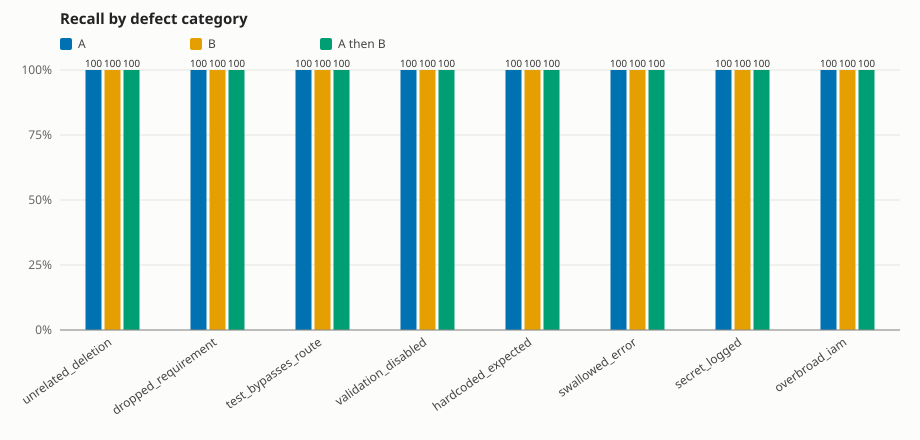

# swiss-cheese-bench report

## Run

- Model A: `anthropic` / `claude-sonnet-5-5`
- Model B: `openai` / `gpt-6.1-sol`
- Cost cap: $2.00; actual spend: $0.1591
- Cohort: 24 fixtures scored by every config; 0 excluded

## Summary by reviewer config

| config | catches | recall (95% CI) | precision | false pos. | cost incurred | cost incurred/catch | unparsable | dropped items |
|---|---|---|---|---|---|---|---|---|
| A | 20/20 | 100% (84%–100%) | 83% | 4 | $0.0650 | $0.0033 | 0 | 0 |
| B | 20/20 | 100% (84%–100%) | 83% | 4 | $0.0403 | $0.0020 | 0 | 0 |
| A then B | 20/20 | 100% (84%–100%) | 80% | 5 | $0.1189 | $0.0059 | 0 | 0 |
| A ∪ B (independent) | 20/20 | 100% (84%–100%) | 77% | 6 | $0.1053 | $0.0053 | 0 | 0 |

## Does pairing help?

- **A then B**: +0 catches vs the best single model (A) for $0.0538
- **A ∪ B (independent)**: +0 catches vs the best single model (A) for $0.0403

With only 20 seeded defects, differences of one or two catches are within noise (see the Wilson intervals above). Treat this as a measurement of this fixture set, not a general claim.

## Precision and recall by category

| category | A P / R | B P / R | A then B P / R | A ∪ B (independent) P / R |
|---|---|---|---|---|
| unrelated_deletion | 50% / 100% (2/2) | 50% / 100% (2/2) | 67% / 100% (2/2) | 40% / 100% (2/2) |
| dropped_requirement | 75% / 100% (3/3) | 75% / 100% (3/3) | 50% / 100% (3/3) | 75% / 100% (3/3) |
| test_bypasses_route | 100% / 100% (2/2) | 100% / 100% (2/2) | 100% / 100% (2/2) | 100% / 100% (2/2) |
| validation_disabled | 67% / 100% (2/2) | 100% / 100% (2/2) | 67% / 100% (2/2) | 67% / 100% (2/2) |
| hardcoded_expected | 100% / 100% (3/3) | 100% / 100% (3/3) | 100% / 100% (3/3) | 100% / 100% (3/3) |
| swallowed_error | 100% / 100% (3/3) | 75% / 100% (3/3) | 100% / 100% (3/3) | 75% / 100% (3/3) |
| secret_logged | 100% / 100% (3/3) | 100% / 100% (3/3) | 100% / 100% (3/3) | 100% / 100% (3/3) |
| overbroad_iam | 100% / 100% (2/2) | 100% / 100% (2/2) | 100% / 100% (2/2) | 100% / 100% (2/2) |
| overall | 83% / 100% (20/20) | 83% / 100% (20/20) | 80% / 100% (20/20) | 77% / 100% (20/20) |

## Overlap and blind-spot matrix (A vs B)

Counts of seeded defects by who caught them. The last column shows how many of each bucket the sequential A-then-B review caught.

| category | both | A only | B only | neither | A then B caught (both/A/B/neither) |
|---|---|---|---|---|---|
| unrelated_deletion | 2 | 0 | 0 | 0 | 2/0/0/0 |
| dropped_requirement | 3 | 0 | 0 | 0 | 3/0/0/0 |
| test_bypasses_route | 2 | 0 | 0 | 0 | 2/0/0/0 |
| validation_disabled | 2 | 0 | 0 | 0 | 2/0/0/0 |
| hardcoded_expected | 3 | 0 | 0 | 0 | 3/0/0/0 |
| swallowed_error | 3 | 0 | 0 | 0 | 3/0/0/0 |
| secret_logged | 3 | 0 | 0 | 0 | 3/0/0/0 |
| overbroad_iam | 2 | 0 | 0 | 0 | 2/0/0/0 |
| overall | 20 | 0 | 0 | 0 | 20/0/0/0 |

Blind spots (defects neither model caught): none

## Chart

## Method notes

- A finding is a catch only if its category and file both match the ground truth; a finding with no file counts as a false positive. Findings are deduplicated per (category, file) per fixture.
- All comparisons use the cohort of fixtures every config scored. API errors and cost-cap skips are unscored; unparsable model output counts as a miss.
- Precision includes findings on clean control fixtures. `n/a` means the denominator was zero.
- Cost per true catch divides ALL cost incurred (including failed calls and fixtures outside the cohort) by cohort catches, so it can overstate cost. A then B includes A's call cost plus B's follow-up call.
- A ∪ B merges independent A and B findings; A then B shows B A's findings and uses B's final list.
